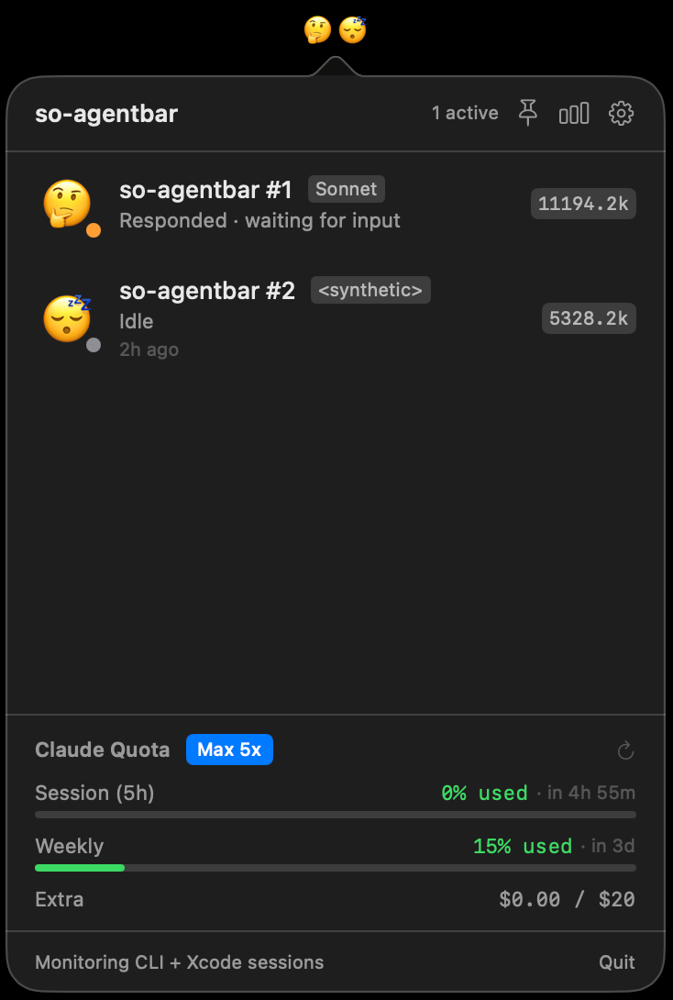
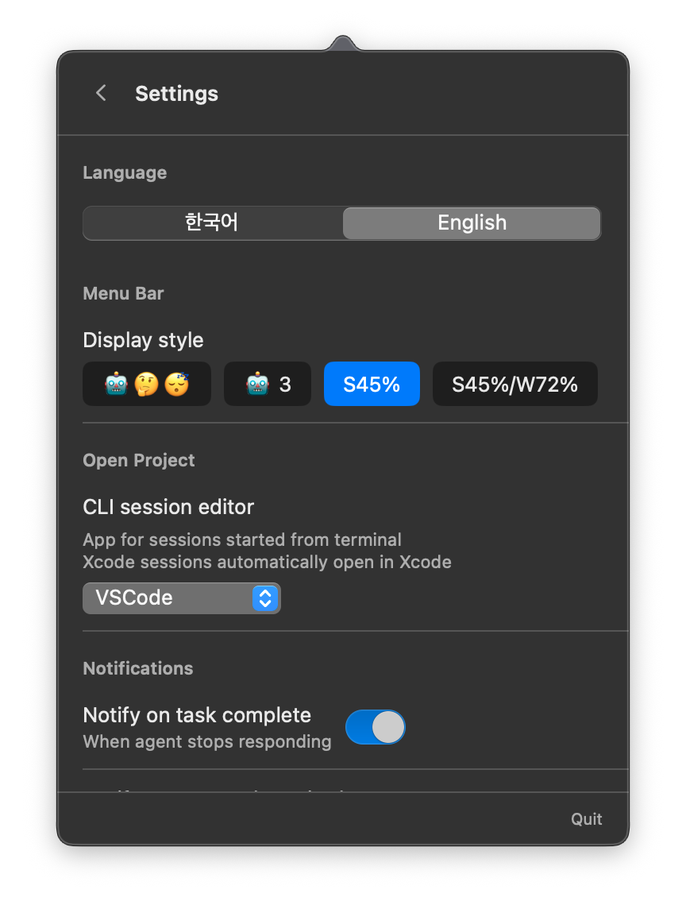
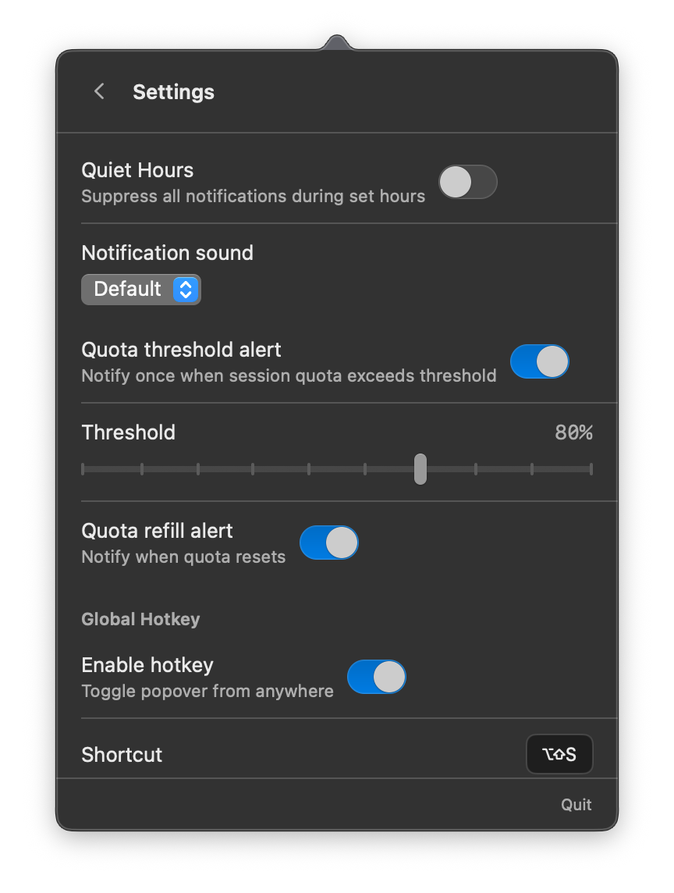
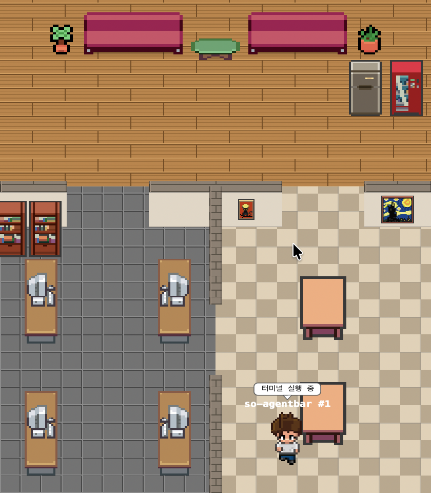

<p align="center">
  
</p>

<h1 align="center">so-agentbar</h1>

<p align="center">
  macOS menu bar app that monitors your active Claude Code and Codex CLI agent sessions in real-time
</p>

<p align="center">
  <a href="https://github.com/sotthang/so-agentbar/releases/latest">Download</a> · <a href="https://sotthang.github.io/so-agentbar/">Website</a>
</p>

<p align="center">
  <a href="https://github.com/sotthang/so-agentbar/releases/latest"></a>
  
  <a href="LICENSE"></a>
  <a href="https://github.com/sotthang/so-adk"></a>
</p>

## Screenshots

<p align="center">
  
  <br><em>Menu bar icon and active session panel</em>
</p>

<p align="center">
  
  &nbsp;&nbsp;
  
  <br><em>Settings: language, notifications, quota threshold, and display options</em>
</p>

<p align="center">
  
  <br><em>Pixel Agents — animated pixel art characters that reflect each session's live status</em>
</p>

## Features

- **Real-time Session Monitoring** — Automatically detects and tracks all running Claude and Codex CLI sessions: Claude (CLI, Xcode, Desktop Code, Cowork) and Codex (CLI, VSCode)
- **Subagent Grouping** — Sessions spawned via the `Agent` tool (e.g. SO-ADK pipelines) are folded under their parent session with a `🤖×N` badge. Click to expand the dropdown and see each subagent's type, current task, and last response on hover. While the parent waits, the parent row mirrors the most active subagent's status, and the parent's token/cost totals include every subagent's usage so you see the full pipeline cost in one place
- **Source Badges** — Each session is labeled by origin (Code, Cowork, Xcode) so you always know where it's running. Click a Desktop session to open Claude Desktop directly
- **Session Titles** — AI-generated session titles from Claude Desktop are shown automatically, replacing cryptic path names
- **Multi-Provider Usage Monitoring** — Track usage and costs across multiple AI coding providers in one place:
  - **Claude** — Precise OAuth-based quota tracking with 5-hour and weekly utilization % from Anthropic API
  - **Codex** — Estimated usage from local `~/.codex/sessions` logs (24-hour rolling window), with token counts and estimated costs. Set via Settings
  - **Cursor** — Exact request count tracking for Cursor free and personal plans. Reads your local Cursor session token and queries `cursor.com/api/usage` for accurate request usage and limits. Shows requests used / limit (if available) with a usage bar. Cost information is not available from Cursor's API. *Note: Uses an unofficial endpoint that may change with Cursor updates.*
  - Each provider displays with clear labels (Claude shows quota %, Codex shows estimated tokens and costs, Cursor shows exact request counts). Providers can be toggled on/off independently. The menu bar icon shows the selected provider's usage — default is Claude for backward compatibility
- **Token & Quota Tracking** — Monitor input/output tokens and API quota usage with 5-hour/weekly utilization. Display the live session/weekly quota % directly in the menu bar, with threshold-based color highlight (red when above your alert threshold)
- **Real-time Activity Indicator** — In quota display mode (S45% or S45%/W72%), the menu bar logo bounces vertically to show agent activity at a glance. Animation speed adapts to concurrent agent count: slower for single agents (0.40s per frame), faster for multiple concurrent operations (0.25s for 2, 0.14s for 3+). Idle sessions show a static logo as before. Classic emoji display modes are unaffected
- **Cost Estimation** — View estimated API costs per session based on model-specific token pricing. Costs and token counts are restored after app restart by re-parsing recent session logs
- **Quiet Hours** — Suppress notifications during designated time windows (e.g., 22:00~09:00)
- **Smart Notifications** — Get notified on task completion, errors, approval requests, quota threshold, and quota refill. Tap a notification to open the project directly in your editor
- **Human-in-the-loop Detection** — Automatically detects when an agent is waiting for your approval and sends an alert
- **Statistics Dashboard** — Daily summary, 7-day chart, and top project rankings
- **Global Hotkey** — Toggle the session panel from anywhere (default: ⌥⇧S)
- **Pixel Agents Window** — Visualize active Claude Code sessions as animated pixel art characters in a floating macOS window. Toggle the window from the session panel header, customize opacity in settings, and watch characters animate based on session status (working, waiting for approval, etc.) Always display resident system monitor pets (CPU and Memory) that react to live system metrics in real-time
- **System Resource Monitor** — Real-time CPU, Memory, and Disk usage display in the menu bar popover. System pets in the pixel window dynamically adjust their movement speed and activity based on current CPU and Memory metrics, replacing the need for separate system monitoring tools
- **Keep Awake** — Toggle keep-awake mode in 3 steps: Off / Always / Auto. Always prevents the Mac from sleeping regardless of session status. Auto activates sleep prevention only when one or more Claude sessions are actively running. The mode button in the session panel header shows the current state with visual feedback
- **Dock Pin** — Keep a bottom Dock on one display. With two or more displays (Sidecar included), touching the bottom edge of another display no longer drags the Dock over, and if it does end up elsewhere it is moved back automatically. Hold Option to move it on purpose. Opt-in, off by default, requires Accessibility permission. See [Dock Pin](#dock-pin) for conditions and cautions
- **Clipboard History** — Track your recent clipboard copies in a dedicated tab. View the 20 most recent text items, search through your clipboard history, and click any entry to restore it to your clipboard. History persists across app restarts
- **Quick Note** — Jot down quick thoughts or reminders in a persistent text editor tab. Your notes auto-save as you type and are restored when you reopen the app
- **Custom Emoji** — Assign unique emoji icons to each project for quick identification
- **Editor Integration** — Open projects directly in VSCode, Cursor, Antigravity, Terminal, or Finder
- **Auto Update** — Built-in updater via Sparkle keeps the app up to date automatically
- **Bilingual UI** — Korean and English support
- **Launch at Login** — Auto-start with macOS via ServiceManagement

## Requirements

- macOS 14.0 (Sonoma) or later
- Active [Claude Code](https://docs.anthropic.com/en/docs/claude-code) or [OpenAI Codex CLI](https://developers.openai.com/codex/cli) sessions

## Install

1. Download `so-agentbar.dmg` from [Releases](https://github.com/sotthang/so-agentbar/releases/latest)
2. Drag `so-agentbar.app` to Applications
3. Launch — so-agentbar appears in your menu bar

### Build from Source

```bash
git clone https://github.com/sotthang/so-agentbar.git
cd so-agentbar
open SoAgentBar.xcodeproj
```

Build and run with Xcode (⌘R).

## How It Works

so-agentbar monitors Claude and Codex agent session logs via FSEvents, and fetches quota usage from cloud APIs:

**Claude sessions**:
- **CLI sessions** — `~/.claude/projects/`
- **Xcode sessions** — `~/Library/Developer/Xcode/CodingAssistant/ClaudeAgentConfig/projects/`
- **Desktop Code sessions** — detected via Claude Desktop metadata (`claude-code-sessions/*.json`)
- **Desktop Cowork sessions** — `~/Library/Application Support/Claude/local-agent-mode-sessions/`

**Codex sessions** (local log-based usage):
- **CLI & VSCode sessions** — `~/.codex/sessions/YYYY/MM/DD/rollout-*.jsonl`
- Codex flushes its rollout JSONL in a batch at turn completion (not as a streaming write), so a Codex session's status updates **after each turn completes** rather than mid-response. Click a Codex session to open the Codex.app.
- Usage tracking parses local JSONL logs over a **24-hour rolling window**, extracting token counts per model and estimating costs. Since Codex has no public quota API, usage is displayed as **estimated** and includes a "Cost N/A" indicator when model unit prices are unknown (e.g., `gpt-5-codex`).

### Usage Monitoring

- **Claude**: Official quota (5-hour and weekly %) fetched from Anthropic's OAuth API (`/api/oauth/usage` endpoint) using the token stored in Keychain. Accurate and real-time.
- **Codex**: Estimated from local `~/.codex/sessions` logs over the past 24 hours. Token counts aggregated per model, costs calculated via `CostCalculator` using OpenAI pricing. Labeled as "estimated" in the UI.
- **Cursor**: Exact request usage queried from `cursor.com/api/usage` using your local Cursor session token (stored in `~/Library/Application Support/Cursor/User/globalStorage/state.vscdb`). Shows request count and limit (if your plan has one) in real-time. Cost information unavailable — Cursor does not publish per-request pricing. *Uses an unofficial API endpoint; may be subject to change.*
- **Gemini**: Reserved for future implementation (data source validation pending).

Session status is determined by parsing JSONL log events. Token and cost data are restored after app restart via incremental log parsing. Cursor request usage is fetched live on each poll interval.

## Dock Pin

Settings → **Dock Pin** → "Keep the Dock on one display", then choose the display in "Keep the Dock on" (default: main display). The status line under the picker shows what the feature is doing right now.

**When it works**
- Two or more active displays. Sidecar counts as a regular secondary display; mirrored displays and Universal Control do not
- The Dock is at the **bottom** of the screen
- **"Displays have separate Spaces"** is on (System Settings → Desktop & Dock; this is the macOS default)

If a condition isn't met, the feature waits and the status line says why (e.g. "Waiting — only one display"). It turns itself back on when you connect a display or move the Dock back to the bottom — no need to touch the toggle.

**Permission** — Accessibility permission is requested only when you turn the feature on. Until it is granted, the status line shows "Open Permission Settings". Once you allow it, the status line usually changes within 1–3 seconds (at most about 5) — no restart needed. If it still says permission is needed after that, the toggle you turned on probably belongs to a different SoAgentBar build (see below).

**Grant permission to the build you are running** — The release app in `/Applications` and a local Xcode build share the bundle ID, so the Accessibility list can show two "SoAgentBar" entries that are actually separate. For an Xcode Debug build:
1. Quit every running SoAgentBar (including the release app)
2. In System Settings → Privacy & Security → Accessibility, remove the SoAgentBar entries with `−` (if you can't tell them apart, remove both and re-allow the release app later)
3. Click `+`, press Cmd+Shift+G and pick `SoAgentBar.app` from DerivedData (Xcode → Product → Show Build Folder in Finder → `Products/Debug/SoAgentBar.app`), then turn it on
4. Run from Xcode

If the build is re-signed ad-hoc, the old entry no longer matches — repeat steps 2–3. Apps under `/private/tmp` don't appear in the list; use `~/Applications` instead.

**Background check** — To confirm the permission, a short-lived process plus a code-signature check (tens of ms) runs every 5 s while pinned (up to about once per second in rare uncertain states). That is roughly 17,000 short launches a day, which endpoint security tools on managed Macs may log. While it is waiting for permission, the check slows down: every 5 seconds for the first minute, every 30 seconds up to 10 minutes, then once a minute (about 1,500 a day). Changing any Accessibility permission, switching to SoAgentBar, or turning Dock Pin back on restarts the 5-second pace. Nothing runs when Dock Pin is off. If the app's binary has changed on disk (e.g. after an update, before relaunch) or the build is unsigned, the background check is skipped and Dock Pin relies on in-process checks until the app is relaunched.

**Moving the Dock on purpose** — Hold **Option** while touching another display's bottom edge. The Dock moves and stays there; use **"Move Dock back now"** in Settings to bring it back.

**Cursor movement** — To move the Dock back, the app briefly moves the cursor to the pinned display's bottom edge and then returns it (at most about 3.5 seconds). If the display the cursor was on is disconnected during this, the cursor goes to the center of the pinned display instead.

> [!WARNING]
> - **Turn off Dock Pin or quit the app before turning off Accessibility permission.** If permission is revoked while the Dock is being moved back, restoring the cursor is not guaranteed.
> - Local Xcode builds and the release build have **separate** Accessibility entries. When cleaning up a local build's entry, first quit every running SoAgentBar (or turn Dock Pin off), then remove it from the list. `tccutil reset Accessibility com.sotthang.soagentbar` can also remove the release build's permission, since both share the bundle ID.

Tested on macOS 27.

## Settings

| Setting | Description |
|---|---|
| Language | Korean / English |
| Menu Bar Style | Emoji, Emoji + Count, Quota Session %, Quota Session + Weekly % |
| Menu Bar Provider | Claude, Codex, Cursor, or Gemini (selects which provider's usage is shown in the menu bar icon) |
| Editor | VSCode, Cursor, Antigravity, Terminal, Finder |
| Notifications | Completion, Approval Required, Error, Quota Threshold (50-95%), Refill |
| Quiet Hours | Suppress all notifications during a set time window (e.g. 23:00–09:00) |
| Global Hotkey | Customizable keyboard shortcut |
| Poll Interval | 10s / 30s / 60s fallback polling |
| Pixel Agents | Opacity slider for the floating pixel character window |
| Idle Sessions | Show or hide idle sessions |
| Keep Awake Mode | Toggle between Off, Always, and Auto (session-dependent) |
| Auto Keep Awake on Session | Automatically prevent sleep when Claude sessions are active |
| Clipboard History | Enable or disable clipboard history tracking and display |
| Dock Pin | Keep a bottom Dock on one chosen display (main display by default); shows live status and "Move Dock back now". Requires Accessibility permission |
| Codex CLI Monitoring | Enable or disable OpenAI Codex CLI/VSCode session tracking (estimated usage from local logs) |
| Cursor Request Monitoring | Enable or disable Cursor (free/personal plan) request usage tracking. Requires Cursor app login |
| Gemini Monitoring | Enable or disable Google Gemini usage tracking (estimated usage from local logs) |
| Launch at Login | Auto-start with macOS |
| Auto Update | Check for updates automatically via Sparkle |

## Changelog

See [Releases](https://github.com/sotthang/so-agentbar/releases) for the full version history and release notes.

## Contributing

Issues and feature requests are welcome! Feel free to open an [issue](https://github.com/sotthang/so-agentbar/issues).

## Built with SO-ADK

This project was developed using [SO-ADK](https://github.com/sotthang/so-adk) — an agentic development kit that orchestrates AI agents through a full TDD pipeline (plan → spec → architect → test → implement → review → docs).

## ☕ Support my work

If this project helped you, please consider sponsoring.

Your support helps me maintain and improve this project.

👉 [https://github.com/sponsors/sotthang](https://github.com/sponsors/sotthang)

## Credits

Pixel Agents character sprites by [PIPOYA](https://pipoya.itch.io/pipoya-free-rpg-character-sprites-32x32) (PIPOYA FREE RPG Character Sprites 32x32).

## License

[MIT](LICENSE)
